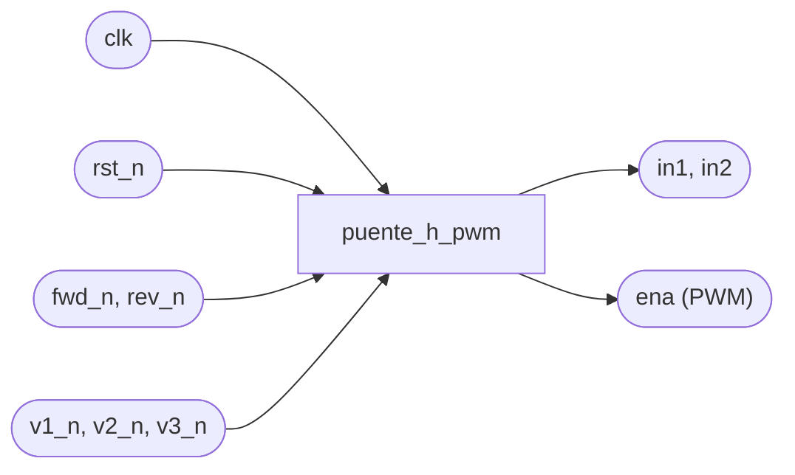
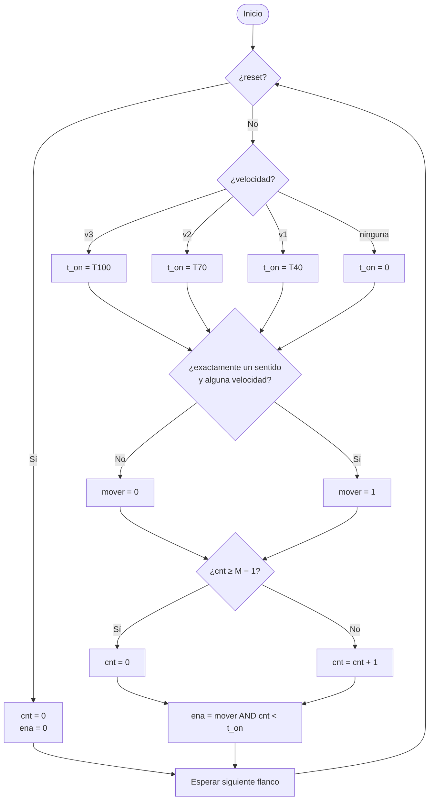

# Bitacora-LAB-3
Lab 3
# Bitácora grupal — Puente H con PWM

**Grupo:** _(G9 / G10, nombres de los integrantes)_
**Repositorio:** _(enlace de GitHub Classroom)_ · **Video:** _(enlace)_
**Tarjeta FPGA:** _(modelo)_ · **Driver del puente H:** _(ej. módulo L298N)_ · **Motor:** _(modelo y voltaje)_

> Estructura de la [Guía de la bitácora](https://github.com/afgalindor1/Laboratorio_Digital_2026_2_G9_G10/tree/main/Labs/Lab_Perifericos).
> **Preinforme = secciones 1 a 5. Informe = secciones 6 y 7.**
> Reglas: fecha en cada entrada, **predicciones antes de ejecutar herramientas**, registrar errores, justificar decisiones, citar fuentes, indicar qué hizo cada integrante.
> **Convención de este borrador:** lo escrito es una propuesta de diseño para que el grupo la revise, la corrija y la haga suya. Lo marcado con `___` o _(…)_ debe completarse con datos reales. Ningún resultado de síntesis, simulación o tarjeta está inventado.

---

## Participación individual

| Integrante | Secciones y tareas a cargo | Commits principales |
|---|---|---|
| | | |
| | | |

---

## 1. Objetivos

**Alcance acordado con el profesor:** _(fecha y resumen de lo acordado)_

**Parámetros asignados al grupo** (ficha del Puente H; el profesor puede cambiarlos):

| Parámetro | Valor base | Valor asignado a nuestro grupo |
|---|---|---|
| Número de velocidades | 3 | ___ |
| Ciclos de trabajo | 40 %, 70 %, 100 % | ___ |
| Frecuencia de la PWM | elegida y justificada por el grupo | ___ |

**Objetivo general** _(reescribir con sus palabras)_: Diseñar, simular e implementar en FPGA un controlador de puente H con PWM que permita elegir el sentido de giro y la velocidad de un motor DC mediante pulsadores.

**Objetivos específicos** _(reescribir con sus palabras)_:
1. Abordar el diseño con método: variables, cuentas de tiempo y bits, caja negra y especificaciones medibles.
2. Describir el comportamiento en Verilog sintetizable y contrastar lo predicho con lo que infiere Yosys.
3. Verificar cada especificación con un testbench automático.
4. Implementar en la FPGA con conexión segura y medir cada especificación en la tarjeta.

---

## 2. Marco teórico (etapa 1)

### 2.1 La tarjeta y `CLK_FREQ`

| Dato | Valor |
|---|---|
| Tarjeta | |
| `CLK_FREQ` supuesto | ___ Hz |
| De dónde se obtuvo | _(archivo `.pcf`, esquemático o marca del oscilador)_ |
| ¿Usa PLL? | _(sí/no; si sí, `CLK_FREQ` es la salida del PLL)_ |
| Verificación experimental | _(sintetizar `parpadeo_dos_velocidades.v`, contar parpadeos en 60 s: ___ parpadeos → `CLK_FREQ` real = ___)_ |
| Periodo del reloj T = 1/f | ___ ns |

> En el resto de este borrador se usa **25 MHz como valor de ejemplo** (el de la BlackIce Mx del curso). **Sustitúyanlo por el suyo y recalculen.**

### 2.2 Preguntas de la ficha (respondan con sus palabras y cita)

| Pregunta | Respuesta | Fuente (hoja de datos, libro, página) |
|---|---|---|
| ¿Qué es un puente H y cómo invierte el sentido de giro? | | |
| ¿Qué hacen IN1, IN2 y ENA? **Tabla de verdad a partir de la hoja de datos, incluido el frenado** | _(ver 2.3)_ | |
| ¿Por qué una PWM controla la velocidad? ¿Qué frecuencia conviene y qué pasa si es muy baja? | | |
| ¿Qué caída de voltaje introduce el driver? ¿Por qué un motor no arranca con ciclos de trabajo pequeños? | | |
| ¿Qué riesgos tiene invertir el sentido con el motor a toda velocidad? | | |

### 2.3 Tabla de verdad del driver (completar con la hoja de datos)

| ENA | IN1 | IN2 | Efecto en el motor |
|---|---|---|---|
| 0 | X | X | _(libre / sin energía)_ |
| 1 | 1 | 0 | _(un sentido)_ |
| 1 | 0 | 1 | _(sentido contrario)_ |
| 1 | 0 | 0 | _(¿freno o parada?)_ |
| 1 | 1 | 1 | _(¿freno o parada?)_ |

### 2.4 Seguridad eléctrica (de la ficha y de "Conexión eléctrica")

- La FPGA es de 3.3 V: **ningún pin recibe 5 V**. Su salida es señal de control, no alimentación del motor.
- Motor con **fuente externa** adecuada a su voltaje. **GND común** entre fuente, módulo y FPGA.
- **Jumper de ENA en el L298N:** de los dos pines marcados ENA, uno es la habilitación y el otro es +5 V del módulo. Para usar PWM se **retira el jumper** y la salida de la FPGA va al pin **ENA**, nunca al de +5 V. Se identifica con multímetro (módulo alimentado, sin jumper: el pin de +5 V marca 5 V respecto a GND). Resultado de nuestra medición: _(registrar)_.

---

## 3. Etapa de diseño del sistema (etapas 2 a 5)

### 3.1 Decisión de arquitectura

| Criterio | A. PWM en ENABLE (imagen 1) | B. PWM sobre IN1/IN2 con AND (imágenes 2 y 3) |
|---|---|---|
| Necesita pin ENABLE en el driver | Sí | No |
| Señales de dirección | Casi estáticas | Llevan el PWM |
| Hardware | Selector de giro + generador PWM | Selector de giro + generador PWM + 2 AND |
| Facilidad de verificar | _(opinión argumentada)_ | _(opinión argumentada)_ |

**Alternativa elegida:** _(A o B)_ · **Razón:** _(p. ej. "nuestro módulo tiene ENA", "lo indicó el profesor")_
**Fecha y responsable de la decisión:** _(…)_

> El resto del documento asume la **alternativa A** (PWM en ENA).

### 3.2 Alcance de control: por nivel

La ficha pide que el motor responda **mientras se mantienen presionados** los pulsadores y que **se detenga sin pulsador**. Eso es **control por nivel**: no hace falta debounce ni detector de flanco. Un esquema de "subir/bajar velocidad" que recuerda el nivel sí los necesita y es una **mejora opcional**, no el alcance base.

**Propuesta de entradas** _(a acordar con el profesor; si faltan pulsadores en la tarjeta, preguntar dónde usar interruptores)_:

| Entrada | Significado |
|---|---|
| `fwd_n`, `rev_n` | Sentido adelante / atrás (activos en bajo) |
| `v1_n`, `v2_n`, `v3_n` | Velocidad 1 (40 %), 2 (70 %), 3 (100 %) (activos en bajo) |
| `rst_n` | Reset (activo en bajo) |

**Decisiones de diseño que hay que documentar** (la ficha pide que estén definidas):

| Situación | Decisión propuesta | Justificación del grupo |
|---|---|---|
| Ningún pulsador | Motor detenido (ENA = 0, IN1 = IN2 = 0) | |
| Sentido sin velocidad | Detenido | |
| Velocidad sin sentido | Detenido | |
| `fwd` y `rev` a la vez | Detenido | |
| Varias velocidades a la vez | Gana la mayor (codificador de prioridad) | |
| Cambio de sentido a toda velocidad | Cambio directo en el alcance base; parada automática = mejora | |

### 3.3 Tabla de variables (etapa 2) — **predicción de flip-flops**

| Variable | Tipo | Valores | Unidad | ¿Se recuerda? | Flip-flops |
|---|---|---|---|---|---|
| `clk` | Entrada | — | — | — | — |
| `rst_n`, `fwd_n`, `rev_n`, `v1_n`, `v2_n`, `v3_n` | Entrada externa | 0/1 | — | Se sincronizan (2 flip-flops c/u) | 12 |
| `in1`, `in2` | Salida | 0/1 | — | No: combinacional desde las entradas sincronizadas | 0 |
| `t_on` | Interna | 0, T40, T70, T100 | ciclos | No: se elige en cada instante | 0 |
| `cnt` | Interna | 0 a M − 1 | ciclos | **Sí**: la cuenta avanza | 15 |
| `fin` | Interna | 0/1 | — | No: comparación | 0 |
| `ena` | Salida | 0/1 | — | **Sí**: salida de la PWM registrada (sin glitches) | 1 |
| | | | | **Total predicho** | **28** |

_Fecha y hora en que se escribió esta predicción: ___ (antes de ejecutar Yosys)._ Si cambian el diseño, rehagan la tabla y registren la fecha.

### 3.4 Tabla de cálculos (etapa 3) — con `CLK_FREQ` = 25 MHz de ejemplo

Frecuencia de PWM elegida: **`F_PWM` = 1 kHz** _(justificar: ¿por qué esa frecuencia?, ¿qué pasa si es muy baja o muy alta con este driver?)_

| Parámetro | Tiempo o frecuencia | Fórmula | Ciclos | Bits | En el código |
|---|---|---|---|---|---|
| Reloj de la tarjeta | `CLK_FREQ` = 25 MHz | — | — | — | `parameter CLK_FREQ = 25_000_000` |
| Periodo de la PWM (M) | 1 ms | CLK_FREQ / F_PWM | 25 000 | 15 | `M = CLK_FREQ / F_PWM` |
| t_on velocidad 1 (40 %) | 0.4 ms | M · 40 / 100 | 10 000 | — | `T40` |
| t_on velocidad 2 (70 %) | 0.7 ms | M · 70 / 100 | 17 500 | — | `T70` |
| t_on velocidad 3 (100 %) | 1 ms | M | 25 000 | — | `T100` (`cnt < M` siempre cierto) |
| Ancho del contador | — | ⌈log₂ 25 000⌉ | — | **15** (2¹⁵ = 32 768) | `ANCHO = $clog2(M)` |

Experimento S4 (anticipado): con `F_PWM` = 20 kHz, M = 1 250 y el contador necesita **11 bits**.

### 3.5 Caja negra y especificaciones (etapa 4)



| ID | Especificación (medible) | Verificación en simulación | Verificación en la tarjeta |
|---|---|---|---|
| E1 | El periodo de `ena` es 1 ms (M ciclos) | Testbench mide el tiempo entre flancos de subida | Osciloscopio o analizador lógico |
| E2 | Velocidad 1: `ena` en alto 40 % del periodo | Testbench mide ancho del pulso (10 000 ciclos) | Medición del duty |
| E3 | Velocidad 2: 70 % | Ancho 17 500 ciclos | Medición del duty |
| E4 | Velocidad 3: `ena` fijo en 1 (100 %) | `ena` no baja durante varios periodos | Nivel constante en el osciloscopio |
| E5 | Adelante: `in1 = 1`, `in2 = 0` | Comprobación directa | Motor gira en un sentido |
| E6 | Atrás: `in1 = 0`, `in2 = 1` | Comprobación directa | Motor gira en el sentido contrario |
| E7 | Sin pulsadores: `ena = 0`, `in1 = in2 = 0` | Comprobación directa | Motor detenido |
| E8 | `fwd` y `rev` a la vez: motor detenido | Comprobación directa | Motor detenido |
| E9 | Dos velocidades a la vez: gana la mayor | Comprobación de duty | Medición |
| E10 | Reset: motor detenido y cuenta en 0 | Comprobación directa | Observación |
| E11 | Ciclo de trabajo mínimo con el que el motor arranca | — | **Solo en la tarjeta**: registrar valor medido |

_(Ajusten E1 a E10 si el profesor asigna otros parámetros.)_

### 3.6 Diagrama de flujo (etapa 5)



_(Verifiquen que cubre todos los casos de la tabla de decisiones de 3.2. Si lo redibujan a mano o en otra herramienta, inserten su versión.)_

### 3.7 Tablas de verdad de los bloques combinacionales

**Selector de giro**

| fwd | rev | in1 | in2 | Estado |
|---|---|---|---|---|
| 0 | 0 | 0 | 0 | Parado |
| 1 | 0 | 1 | 0 | Adelante |
| 0 | 1 | 0 | 1 | Atrás |
| 1 | 1 | 0 | 0 | Parado (caso inválido) |

**Selector de velocidad (codificador de prioridad)**

| v3 | v2 | v1 | t_on | velocidad válida |
|---|---|---|---|---|
| 1 | X | X | T100 | 1 |
| 0 | 1 | X | T70 | 1 |
| 0 | 0 | 1 | T40 | 1 |
| 0 | 0 | 0 | 0 | 0 |

### 3.8 Diagrama de bloques con nombres y anchos

Dibujen el suyo (equivalente a la imagen 1 del profesor) con: sincronizadores (6 × 2 FF) → selector de giro (`in1`, `in2`) · selector de velocidad (`t_on`, ANCHO bits) → contador de periodo (ANCHO bits, `fin`) → comparador `cnt < t_on` → registro `ena`. _(Insertar imagen)_

---

## 4. Etapa de descripción en HDL (etapas 6 y 7)

### 4.1 Código Verilog (borrador)

Debe estar en `src/puente_h_pwm.v` del repositorio. Revísenlo, entiéndanlo línea por línea y modifíquenlo con sus decisiones.

```verilog
module puente_h_pwm #(
    parameter CLK_FREQ = 25_000_000,
    parameter F_PWM    = 1_000
)(
    input  wire clk,
    input  wire rst_n,
    input  wire fwd_n, rev_n,
    input  wire v1_n, v2_n, v3_n,
    output wire in1, in2,
    output reg  ena
);
    // Cuentas (etapa 3)
    localparam M     = CLK_FREQ / F_PWM;
    localparam T40   = M * 40 / 100;
    localparam T70   = M * 70 / 100;
    localparam T100  = M;
    localparam ANCHO = $clog2(M);

    // Entradas externas: invertir y sincronizar (12 flip-flops)
    reg [5:0] meta, sync;
    always @(posedge clk) begin
        meta <= ~{rst_n, fwd_n, rev_n, v1_n, v2_n, v3_n};
        sync <= meta;
    end
    wire rst = sync[5];
    wire fwd = sync[4];
    wire rev = sync[3];
    wire v1  = sync[2];
    wire v2  = sync[1];
    wire v3  = sync[0];

    // Selector de giro (combinacional)
    assign in1 = fwd & ~rev;
    assign in2 = rev & ~fwd;

    // Selector de velocidad: mux de constantes con prioridad (combinacional)
    wire [ANCHO-1:0] t_on = v3 ? T100 : v2 ? T70 : v1 ? T40 : {ANCHO{1'b0}};

    // Contador del periodo (ANCHO flip-flops)
    reg [ANCHO-1:0] cnt;
    wire fin = (cnt >= M - 1);
    always @(posedge clk) begin
        if (rst || fin) cnt <= 0;
        else            cnt <= cnt + 1;
    end

    // PWM registrada (1 flip-flop)
    wire mover = (in1 | in2) & (v1 | v2 | v3);
    always @(posedge clk) begin
        if (rst) ena <= 1'b0;
        else     ena <= mover & (cnt < t_on);
    end
endmodule
```

### 4.2 Relación código ↔ diagrama de flujo

| Diagrama de flujo | Código | ¿Se recuerda? |
|---|---|---|
| Rombo "¿reset?" | `if (rst ...)` en los dos `always` | — |
| Rombo "¿velocidad?" y acciones `t_on = ...` | `wire t_on = v3 ? ... : v2 ? ... : ...` | No |
| Rombo "¿un sentido y alguna velocidad?" | `assign in1/in2` y `wire mover` | No |
| Rombo "¿cnt ≥ M − 1?" | `wire fin = (cnt >= M - 1)` | No |
| Acciones sobre `cnt` | `always @(posedge clk)` con `<=` | Sí |
| `ena = mover AND cnt < t_on` | `always @(posedge clk)` con `ena <=` | Sí |
| "Esperar el siguiente flanco" | Implícito en `posedge clk` | — |

_(Expliquen con sus palabras por qué `>=` y no `==`, y por qué `ena` es registrada.)_

### 4.3 Experimento S1 — predicción vs. síntesis

La predicción se escribió **antes** en 3.3 (28 flip-flops). Predicción de bloques _(completar antes de ejecutar)_:

| Elemento | Predicción | Resultado de Yosys | Explicación de la diferencia |
|---|---|---|---|
| Flip-flops | 28 (12 sync + 15 `cnt` + 1 `ena`) | | |
| Sumadores / restadores | 1 sumador (`cnt + 1`); el `M − 1` es constante | | |
| Comparadores | 1 de magnitud `cnt < t_on` (variable); `cnt >= M-1` contra constante | | |
| Multiplexores | 1 cadena para `t_on` (selección entre constantes) | | |

Comandos:

```bash
yosys -p "read_verilog src/puente_h_pwm.v; hierarchy -top puente_h_pwm; proc; opt; stat"
yosys -p "read_verilog src/puente_h_pwm.v; synth_ice40 -top puente_h_pwm; stat"
```

Salida de Yosys: _(pegar o adjuntar captura)_

### 4.4 Experimento S2 — dos descripciones, un comportamiento

Propuestas (elijan una o ambas): `==` vs. `>=` en el reinicio del contador; `case` de constantes vs. fórmula (nivel × paso) para `t_on`.

| | Versión A | Versión B |
|---|---|---|
| Código | | |
| RTL (imagen) | | |
| Flip-flops / LUT | | |
| Comportamiento en simulación | | |

**¿Cuál es mejor y por qué?** _(…)_ Archivos en `experimentos/`.

### 4.5 Experimento S3 — error provocado (latch)

- Qué se cambió (p. ej. quitar el valor por defecto de un `always @(*)` del selector de velocidad): _(…)_
- Aviso de Yosys (`Latch inferred ...`) y celda `$dlatch`: _(pegar)_
- Qué cambia en la simulación: _(…)_
- Dónde queda la versión corregida: `src/`

---

## 5. Etapa de simulación (etapa 8)

### 5.1 Parámetros del testbench

| Parámetro | Valor | Justificación |
|---|---|---|
| `CLK_FREQ_TB` | _(ej. 1 MHz)_ | El intervalo más corto (el `t_on` del 40 %) debe durar ≥ 10 ciclos |
| `F_PWM` en simulación | | |
| Ciclos por periodo, por `t_on` | | |

### 5.2 Qué especificación verifica cada prueba

| Prueba | ID | Estímulo | Medición / criterio | Resultado (`OK` / `ERROR`) |
|---|---|---|---|---|
| Periodo | E1 | `fwd` + `v2` mantenidos | Tiempo entre flancos de subida de `ena` = 1 ms | |
| Duty v1 | E2 | `fwd` + `v1` | Ancho del pulso = 40 % del periodo | |
| Duty v2 | E3 | `fwd` + `v2` | Ancho = 70 % | |
| Duty v3 | E4 | `fwd` + `v3` | `ena` constante en 1 | |
| Adelante | E5 | `fwd` | `in1 = 1`, `in2 = 0` | |
| Atrás | E6 | `rev` | `in1 = 0`, `in2 = 1` | |
| Sin pulsadores | E7 | ninguno | `ena = 0`, `in1 = in2 = 0` | |
| Ambos sentidos | E8 | `fwd` + `rev` | Detenido | |
| Varias velocidades | E9 | `v1` + `v3` | Gana la mayor | |
| Reset | E10 | `rst_n = 0` | Detenido, `cnt = 0` | |

### 5.3 Evidencia

- Mensajes `OK` / `ERROR` de la terminal: _(pegar)_
- Capturas de GTKWave con **marcadores y tiempo medido visibles**, comparadas con la tabla de cálculos de 3.4: _(insertar)_
- Si algo falló: qué falló, cómo se detectó, la corrección y la nueva simulación: _(…)_

Comando: `make sim` (equivale a `iverilog -o sim.vvp tb_... src/...; vvp sim.vvp; gtkwave ...`).

---

## 6. Etapa de implementación (etapa 8) — _informe_

### 6.1 Archivo de restricciones y tabla de conexiones

| Señal del top | Dirección | Pin de la FPGA | Conector y pin físico | Conectado a |
|---|---|---|---|---|
| `clk` | Entrada | | | Oscilador |
| `rst_n` | Entrada | | | Pulsador de reset |
| `fwd_n` | Entrada | | | Pulsador |
| `rev_n` | Entrada | | | Pulsador |
| `v1_n`, `v2_n`, `v3_n` | Entrada | | | Pulsadores |
| `in1` | Salida | | | IN1 del módulo |
| `in2` | Salida | | | IN2 del módulo |
| `ena` | Salida | | | Pin **ENA** del módulo (no el de +5 V) |
| GND | — | | | GND de la fuente externa (común) |

La tabla debe coincidir con el `.pcf`. Los nombres de los puertos deben ser idénticos. _(Adjuntar el archivo.)_

### 6.2 Montaje

Esquema o foto con **fuente externa y tierra común visibles**: _(insertar)_

**Antes de energizar** (de la guía de conexión eléctrica):
- [ ] Conexiones hechas con las fuentes apagadas.
- [ ] Polaridad de la fuente revisada.
- [ ] Ningún pin de la FPGA recibe más de 3.3 V.
- [ ] La fuente externa y la FPGA comparten GND.
- [ ] El motor no se alimenta desde la tarjeta.
- [ ] Jumper de ENA retirado y salida de la FPGA en el pin correcto.

### 6.3 Verificación de cada especificación en la tarjeta

| ID | Resultado medido | Instrumento | Evidencia (foto, captura) |
|---|---|---|---|
| E1 | | | |
| E2 | | | |
| E3 | | | |
| E4 | | | |
| E5, E6 | | | |
| E7, E8, E9, E10 | | | |
| E11 (duty mínimo de arranque) | | | |

Se recomienda probar primero con LEDs y luego con el motor. Comando: `make clean syn conf`.

### 6.4 Experimento S4 — cambio de parámetro

Cambiar `F_PWM` de 1 kHz a 20 kHz (o el cambio que se indique).

| | `F_PWM` = 1 kHz | `F_PWM` = 20 kHz |
|---|---|---|
| M (ciclos) | 25 000 _(con su `CLK_FREQ`: ___)_ | 1 250 _(___)_ |
| Bits del contador | 15 | 11 |
| Flip-flops reales | | |
| LUT y carry | | |

**¿Coincide con las cuentas?** _(…)_ **¿Cambia el comportamiento del motor?** _(…)_

### 6.5 Experimento S5 — reporte de implementación

Salida de `make syn`: celdas lógicas usadas ___ · flip-flops ___ · frecuencia máxima reportada ___ MHz frente a `CLK_FREQ` = ___ MHz. **Avisos** de la herramienta y su análisis: _(…)_

### 6.6 Cambio en vivo (si el profesor lo pide)

Qué se pidió: ___ · qué se recalculó: ___ · resultado: ___

---

## 7. Resultados y análisis — _informe_

### 7.1 Diseñado vs. simulado vs. implementado

| ID | Diseñado | Simulado | Implementado | Observaciones |
|---|---|---|---|---|
| E1 | 1 ms | | | |
| E2 | 40 % | | | |
| E3 | 70 % | | | |
| E4 | 100 % | | | |
| E5 a E10 | | | | |
| E11 | — | — | | |

### 7.2 Problemas encontrados y soluciones

| Problema | Cómo se detectó | Cómo se corrigió | Commit |
|---|---|---|---|
| | | | |

_(Ejemplos de lo que suele aparecer: PWM invertido, pulsador activo en bajo sin invertir, `CLK_FREQ` incorrecto, tierras sin unir, pin de +5 V confundido con ENA.)_

### 7.3 Limitaciones y mejoras

Propuestas: parada automática antes de invertir el sentido, rampa de aceleración, botón de freno, "subir/bajar velocidad" con debounce y detector de flanco. **Implementadas:** _(cuáles)_. **Propuestas:** _(cuáles)_.

### 7.4 Conclusiones

_(Qué aprendieron sobre el diseño y sobre las herramientas. En sus palabras.)_

---

## Anexo A. Registro de sesiones

### Sesión N — AAAA-MM-DD
- **Asistentes:**
- **Objetivo:**
- **Actividades (quién hizo qué):**
- **Decisiones y por qué:**
- **Errores y correcciones:**
- **Evidencia (commits, capturas):**
- **Pendientes y responsables (con fecha):**

## Anexo B. Commits justificados (criterio habilitante)

| Commit | Autor | Qué cambió | Por qué |
|---|---|---|---|
| | | | |

El historial debe mostrar el proceso real: predicción, primer intento, errores, correcciones.

## Anexo C. Estructura del repositorio y README

```
├── src/              # módulos Verilog del diseño
├── testbench/        # testbenches
├── constraints/      # archivo de restricciones físicas (.pcf)
├── experimentos/     # versiones usadas en S2, S3 y S4
├── Makefile          # el de los ejemplos .zip, adaptado
└── README.md
```

README corto: qué hace el diseño, cómo simularlo y sintetizarlo, entradas y salidas, enlace al video.

## Anexo D. Video (máx. 5 min, según lo que indique el profesor)

- [ ] Explica el flujo con **su propio diseño**: variables, cuentas, caja negra, diagrama de flujo, Verilog, RTL y comparación con la predicción, simulación y síntesis.
- [ ] Muestra el prototipo funcionando, con cada especificación.
- [ ] Comenta un problema encontrado y cómo se resolvió.
- [ ] Enlace incluido en el README y en la bitácora.

---

## Lista de verificación antes de entregar

**Preinforme**
- [ ] Objetivos propios, alcance y parámetros asignados.
- [ ] Marco teórico con fuentes citadas y `CLK_FREQ` verificado.
- [ ] Tabla de variables con la predicción de flip-flops (escrita antes de sintetizar).
- [ ] Tabla de cálculos, caja negra y especificaciones medibles.
- [ ] Diagrama de flujo, tablas de verdad y diagrama de bloques.
- [ ] Verilog sintetizable y trazable al diagrama de flujo.
- [ ] Experimentos S1, S2 y S3 registrados.
- [ ] Testbench que verifica cada especificación, con capturas.

**Informe**
- [ ] Restricciones, tabla de conexiones y montaje seguro.
- [ ] Cada especificación verificada en la tarjeta.
- [ ] Experimentos S4 y S5 registrados.
- [ ] Comparación diseñado / simulado / implementado y conclusiones.

**Repositorio y video**
- [ ] Código, testbench y restricciones organizados, con README corto.
- [ ] Commits que muestran el proceso.
- [ ] Video con el flujo completo y el prototipo funcionando.

**Sustentación**
- [ ] Cada integrante puede explicar todo el diseño y recalcular un cambio en vivo (otro tiempo, otro duty, otra frecuencia).
